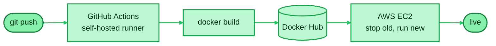

<!-- Add your links here, then uncomment:

🌐 Portfolio: https://your-portfolio-url · 💼 LinkedIn: https://www.linkedin.com/in/your-handle

-->

## `$ ./deploy.sh`

A Flask app deployed end to end by a CI/CD pipeline I built: every push builds a Docker image, publishes it, and redeploys the container on AWS EC2 through a self-hosted GitHub Actions runner.

<!-- Link the repo: [View the project](https://github.com/meryambej/your-repo) -->

## `$ cat stats`

