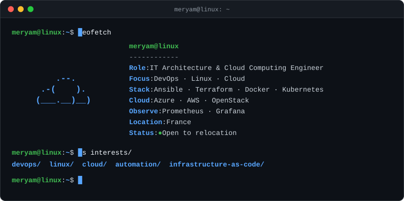
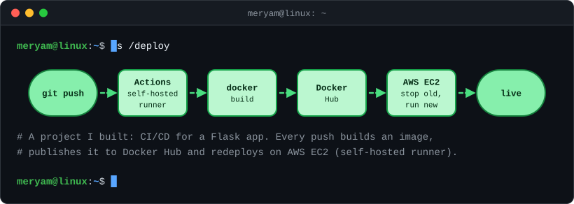
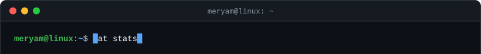
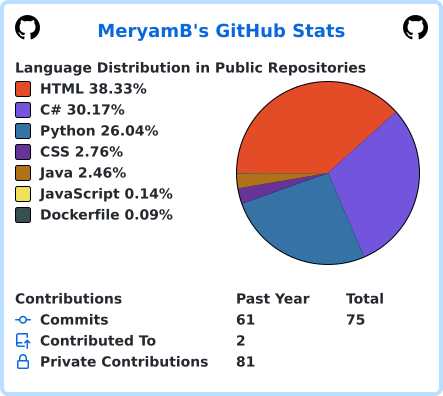

# Hi, I'm Meryam 
**IT Architecture & Cloud Computing Engineer ☁️**

I code, automate infrastructure, break things in VMs (on purpose… mostly 😏), and live in the terminal. And yes, coffee is part of the infrastructure ☕

 

